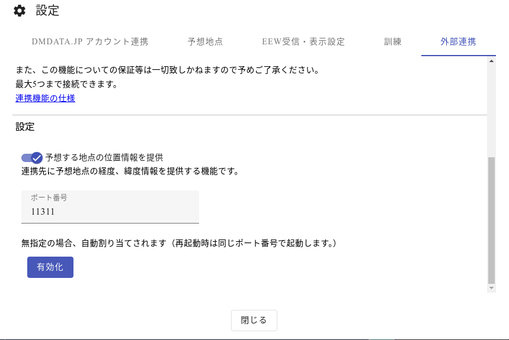
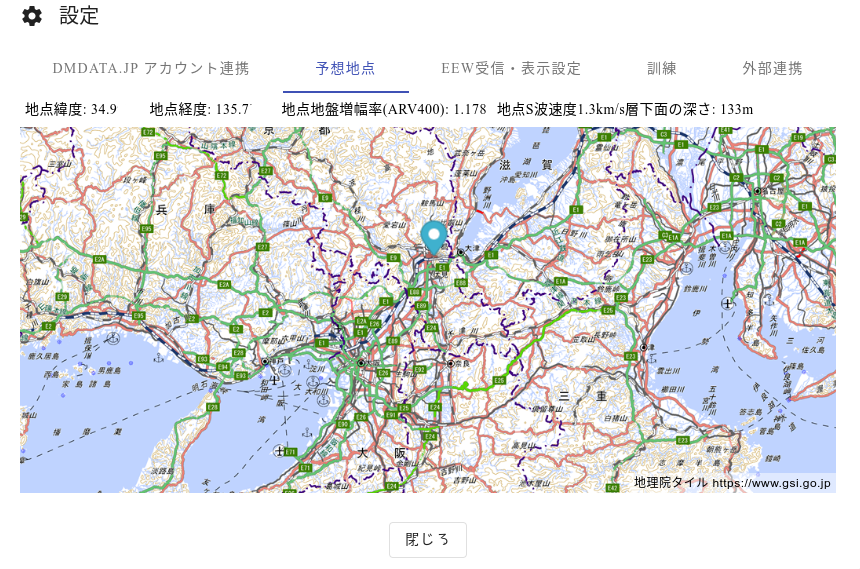

# EEW Client by DMDATA.JP EEW

[ [English](./EEWC-about-en.md) | **日本語** ]

<a href="https://dmdata.jp/eewclient/">EEW Client</a>は、<a href="https://dmdata.jp/">Project DM-D.S.S</a>によるアプリケーションおよびサービスです。 
KyoQuakeをEEW Clientに接続することで、緊急地震速報を受信することができます。

## 重要

- EEW Clientはサブスクリプションが必要な有料サービスです。（下記参照）
- EEW Clientで受信したデータの商用利用や複製は禁止されています。
- SNS（動画、ライブ配信など）での使用には、EEW Clientを使用していることを明記する必要があります。KyoQuakeでは緊急地震速報の情報にEEW Clientを配信元として表示することでこれを満たしますが、動画の説明欄などでEEW Clientを記載しリンクすることをおすすめします。
- 詳細は<a href="https://dmdata.jp/docs/eewclient-external-server">こちら（日本語）</a>。

## 使用方法

### セットアップ

まず、<a href="https://dmdata.jp/eewclient/">こちら</a>からEEW Clientをセットアップ・インストール・起動してください。バージョン1.4.0以降が必要です。 
アプリを開いたら設定パネルを開き、最後のタブ「外部連携」に移動します。 

「ポート番号」にポート番号を入力します。不明な場合は`11311`を使用してください。 
次に、青い「有効化」ボタンをクリックして、EEW Clientの外部サービスを開始します。 
*推奨：上部の「予想地点...」オプションも有効にしてください。* 

正常に動作している場合、「WebSocket URL」と赤いボタンが表示されます。

**重要：** EEW Clientは緊急地震速報をKyoQuakeに送信するために起動したままにする必要があります。閉じると、ローカルのWebSocket接続も閉じられます。 

KyoQuakeの外部サービス設定でこのポート番号を入力し、**緊急地震速報の配信元**にEEW Clientを選択して、接続を有効にしてください。

### サブスクリプションとアカウント

EEW Clientで緊急地震速報を受信するには、次のいずれかが必要です：
- EEW Clientサービスのサブスクリプション（月額550円）
- 緊急地震速報（予報）APIスコープのサブスクリプション（月額1650円）

次に、EEW Clientの設定の最初のタブでDM-D.S.Sアカウントをリンクします。
*DMDATA.JPのアカウントリンク確認ページで、下部の2番目の白いボタンを押して確認します。*

### 設定

EEW Clientのいくつかの設定を変更することをおすすめします。

**1.** ホーム場所 
2番目のタブ「予想地点」でホーム場所を設定できます。地図を移動してクリックし、ホーム場所を選択してください。 
*KyoQuakeはEEW Clientからホーム場所を同期できますが、その逆はできません。そのため、ここで設定することが重要です。*

**2.** 1点計算の緊急地震速報 
EEW Clientの設定で有効にすると、低精度の緊急地震速報を受信できます。 
3番目のタブ「EEW 受信」で「1点計算の予想を表示する」までスクロールし、設定を有効にしてください。

**3.** テスト 
4番目のタブ「訓練」でテストシナリオを実行し、EEW Client接続の機能をテストできます。

*EEW ClientはローカルWebSocketへの最大5つの接続をサポートしているため、KyoQuake以外のアプリと同時に使用できます。*
